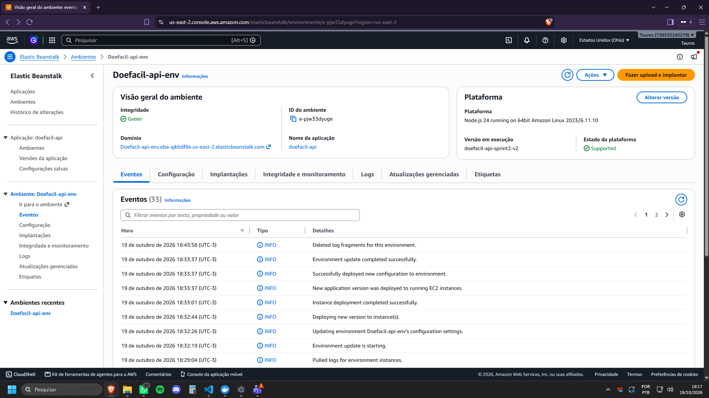
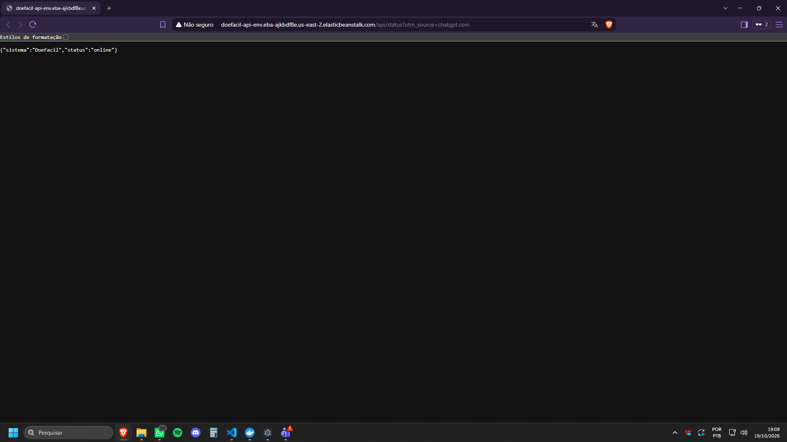
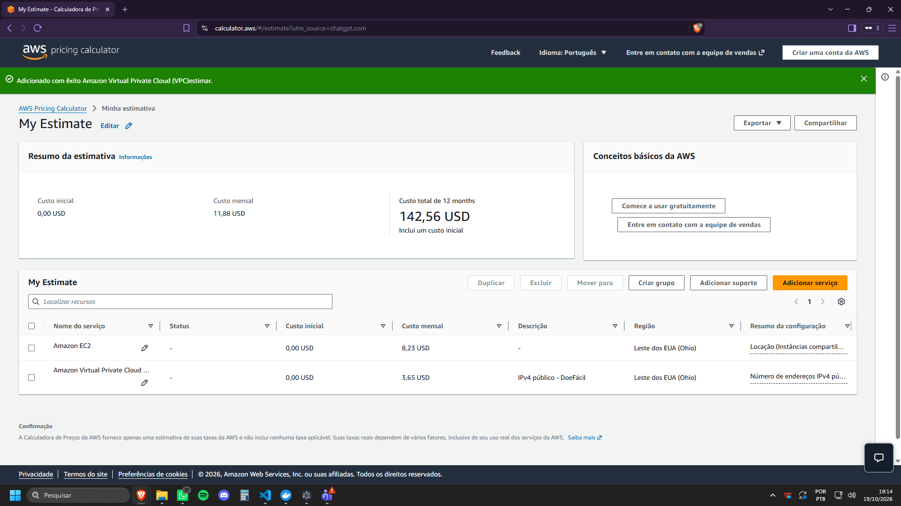

# Computação em Nuvem II — Sprint 2 (AWS)

## 1. Ambiente criado

Em 19/10/2026, configuramos um ambiente na AWS Elastic Beanstalk para hospedar a API do projeto DoeFácil, desenvolvida em Node.js, Express e TypeScript.

Essa etapa dá continuidade ao trabalho realizado em 13/10/2026, quando o grupo configurou o banco PostgreSQL no Neon e testou sua conexão com a API local. Essa configuração está documentada em `docs/sprint2/nuvem.md`.

| Configuração | Valor |
|---|---|
| Provedor | Amazon Web Services (AWS) |
| Serviço | Elastic Beanstalk |
| Aplicação | doefacil-api |
| Ambiente | Doefacil-api-env |
| Região | US East 2 — Ohio |
| Plataforma | Node.js 24 — Amazon Linux 2023 |
| Versão da plataforma | 6.11.10 |
| Instância EC2 | t3.micro |
| Arquitetura | x86_64 |
| Tipo de ambiente | Instância única |
| Monitoramento | Básico |

Utilizamos uma única instância EC2 para realizar os testes iniciais da API na nuvem, sem configurar balanceamento de carga nesta etapa.

## 2. Configuração realizada

Antes da implantação, executamos os comandos `npm run build` e `npm test` para compilar o backend e verificar seu funcionamento. Os 24 testes automatizados foram aprovados.

Depois, criamos um arquivo ZIP contendo os arquivos necessários para executar a aplicação:

- `dist/` — arquivos JavaScript compilados;
- `package.json` — dependências e scripts do projeto;
- `package-lock.json` — versões das dependências.

Enviamos o pacote ao AWS Elastic Beanstalk e realizamos a implantação da aplicação.

A versão `doefacil-api-sprint2-v2` foi implantada com sucesso, e o ambiente apresentou integridade `Green` no console da AWS.

## 3. Verificação realizada

A API foi disponibilizada no endereço:

http://doefacil-api-env.eba-ajkbdf8e.us-east-2.elasticbeanstalk.com

Para verificar seu funcionamento, executamos no PowerShell:

```powershell
Invoke-RestMethod "http://doefacil-api-env.eba-ajkbdf8e.us-east-2.elasticbeanstalk.com/api/status"
```

O retorno obtido foi:

```text
sistema    status
-------    ------
DoeFacil   online
```

Também acessamos a rota `/api/status` pelo navegador, que retornou:

```json
{
  "sistema": "DoeFacil",
  "status": "online"
}
```

Com esses testes, confirmamos que a API estava executando no Elastic Beanstalk e podia ser acessada pela internet.

## 4. Banco de dados

O banco PostgreSQL do DoeFácil já está configurado no Neon, utilizando o plano Free, conforme documentado em `docs/sprint2/nuvem.md`.

O grupo criou as oito tabelas do sistema, inseriu os dados de teste e verificou a conexão com o banco pelas rotas `/api/health` e `/api/itens`, utilizando a API local.

Na AWS, validamos a rota `/api/status`, que não depende do banco de dados.

A conexão da API hospedada no Elastic Beanstalk com o PostgreSQL do Neon ainda precisa ser configurada e testada. Por esse motivo, não podemos confirmar nesta etapa o funcionamento das rotas que dependem do banco no ambiente AWS.

## 5. Estimativa de custos

Utilizamos a AWS Pricing Calculator para estimar o custo mensal da infraestrutura configurada.

O cálculo considera uma instância EC2 `t3.micro` funcionando continuamente, um volume de armazenamento EBS gp3 de 8 GB e um endereço IPv4 público.

| Recurso | Custo mensal estimado |
|---|---:|
| EC2 t3.micro | US$ 7,59 |
| Armazenamento EBS gp3 — 8 GB | US$ 0,64 |
| Endereço IPv4 público | US$ 3,65 |
| **Total estimado** | **US$ 11,88** |

A estimativa considera 730 horas de funcionamento por mês. Para um período de 12 meses, a calculadora apresentou o valor total de US$ 142,56.

Esses valores representam uma simulação de custos, não uma cobrança efetivamente realizada. Também não consideram possíveis despesas adicionais, como transferência de dados, nem os créditos promocionais disponíveis na conta AWS.

O Elastic Beanstalk não possui cobrança adicional pelo gerenciamento do ambiente. Entretanto, os recursos utilizados, como EC2, armazenamento EBS e endereços IPv4 públicos, podem gerar cobranças.

Como o ambiente foi criado para testes acadêmicos, os recursos deverão ser encerrados após a utilização para evitar custos desnecessários. A documentação será mantida para permitir uma nova implantação futuramente.

## 6. Evidências

### 6.1. Ambiente no Elastic Beanstalk

Criamos o ambiente `Doefacil-api-env` na região Ohio, utilizando a plataforma Node.js 24 e uma instância EC2 `t3.micro`.

Após a implantação, o console da AWS apresentou a versão `doefacil-api-sprint2-v2` em execução, com integridade `Green`.



### 6.2. API funcionando na AWS

Acessamos a rota `/api/status` pelo navegador e pelo PowerShell.

Nos testes, a API retornou o status `online`, confirmando que a aplicação estava acessível pela internet.



### 6.3. Estimativa de custos

Consultamos a AWS Pricing Calculator para calcular o custo estimado da infraestrutura.

Considerando EC2, armazenamento EBS e endereço IPv4 público, o valor estimado foi de US$ 11,88 por mês e US$ 142,56 para 12 meses.



## 7. Limites desta entrega e próximas etapas

Nesta etapa, conseguimos implantar a API na AWS e verificar seu funcionamento pela rota de status.

O banco PostgreSQL também está disponível na nuvem, por meio do Neon, mas a conexão entre os dois serviços ainda não foi validada.

Como próximos passos, será necessário:

- Configurar a conexão entre a API hospedada na AWS e o PostgreSQL do Neon;
- Testar os endpoints que utilizam o banco de dados;
- Verificar a integração da API hospedada com as telas do sistema;
- Avaliar a configuração de HTTPS para acesso seguro à aplicação.

Ainda não foram configurados balanceamento de carga ou alta disponibilidade. Essas melhorias poderão ser avaliadas nas próximas etapas do projeto.

## 8. Referências

- AWS — Elastic Beanstalk para Node.js: https://docs.aws.amazon.com/elasticbeanstalk/latest/dg/create_deploy_nodejs.html
- AWS — Pacotes de código-fonte: https://docs.aws.amazon.com/elasticbeanstalk/latest/dg/applications-sourcebundle.html
- AWS Pricing Calculator: https://calculator.aws/
- Neon — Conexão de aplicações ao banco: https://neon.com/docs/connect/connect-from-any-app
- Repositório DoeFácil: https://github.com/FatecFranca/DSM-G06-PI6-2026-2

**Data da configuração e consulta:** 19/10/2026.
