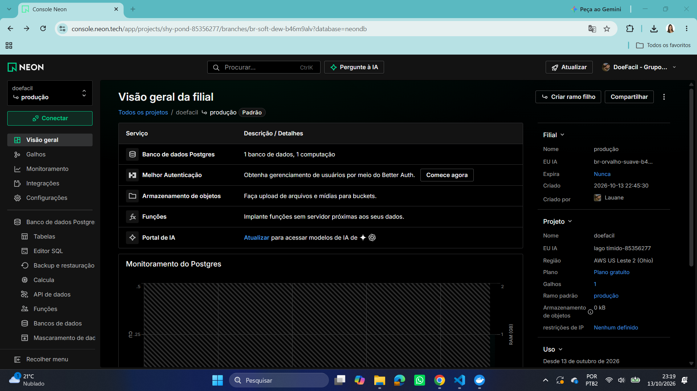
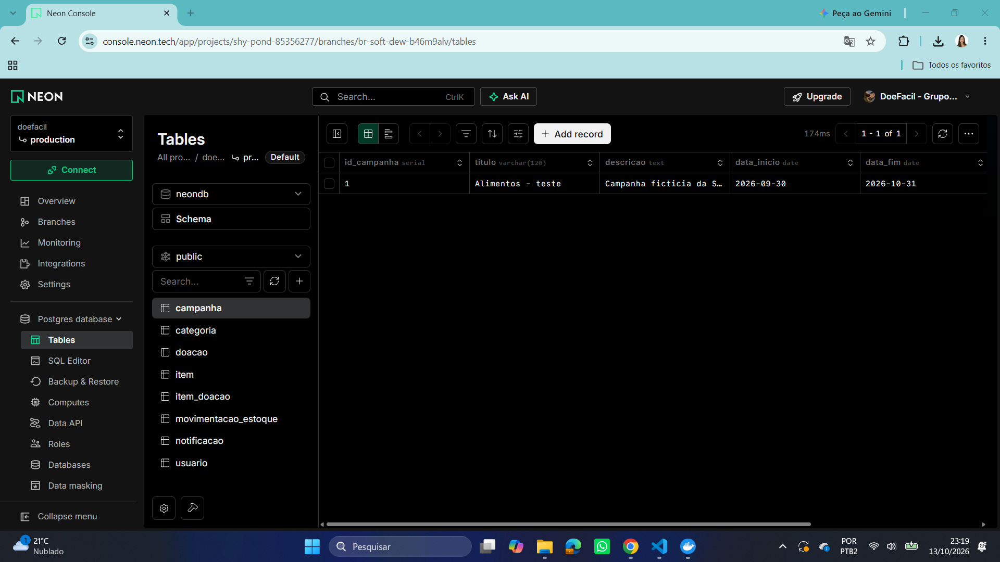
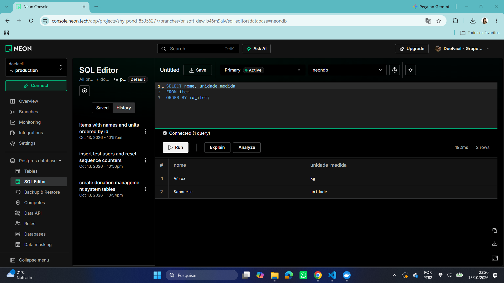
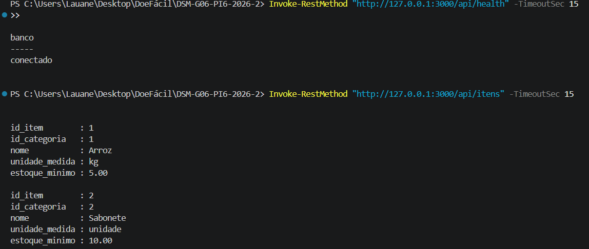
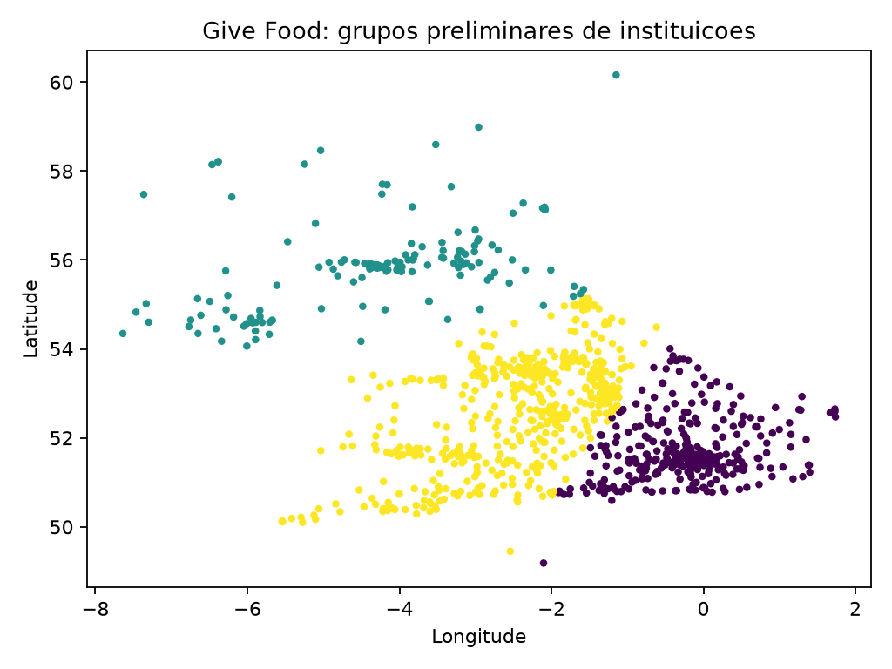

# DoeFácil Documentação da segunda Sprint

Ana Júlia Alves Mota; Lauane Gabriela de Araújo Toledo; Pedro Henrique Cintra Silva.

Fatec Franca. Desenvolvimento de Software Multiplataforma. 6º semestre. Grupo 06.

Revisão de 15/10/2026. Versão do projeto: f9e69c450c7eb1957b871ccf587e277807d526cf.

## 1 INTRODUÇÃO E EVOLUÇÃO DO PROJETO

Nesta segunda Sprint, avançamos da estrutura inicial do DoeFácil para uma versão com operações persistidas no banco de dados. O doador já consegue se cadastrar, entrar no aplicativo e cadastrar, consultar, editar e cancelar suas doações. A aplicação web utiliza a API para gerenciar campanhas.

Mantivemos o escopo de atendimento a uma instituição social. O projeto continua sem pagamentos, serviço de entrega ou cadastro de informações sensíveis dos beneficiários. A integração completa do desktop e do controle de estoque permanece para as próximas etapas.

Este relatório reúne o estado da branch main consultado em 15/10/2026, no commit f9e69c4. A configuração do banco em nuvem foi realizada em 13/10/2026 e está documentada com capturas de tela do grupo.

| Entrega da Sprint 2 | Situação registrada |
| --- | --- |
| Endpoints básicos da API | Cadastro e login; CRUD de campanhas e de doações. |
| Integração com o front-end | Mobile e web fazem requisições à API; desktop ainda estático. |
| Banco implementado | PostgreSQL com oito tabelas e dados de teste. |
| Participação no GitHub | Commits de Lauane, Ana Júlia e Pedro integrados à main. |
| Ambiente em nuvem | PostgreSQL no Neon acessado pela API local. |
| Mineração inicial | Pré-processamento e K-Means com 1.023 instituições. |
| Documentação intermediária | Descrição das implementações, trechos de código, resultados e prints. |

As seções seguintes descrevem as operações disponíveis e os resultados registrados. As funcionalidades ainda incompletas são relacionadas ao final para orientar a continuidade do projeto.

## 2 ENDPOINTS BÁSICOS DA API

O back-end utiliza Node.js, Express e TypeScript. As rotas compartilham a conexão PostgreSQL configurada em backend/src/db.ts. O middleware proteger valida o token JWT e, quando necessário, o perfil do usuário.

| Método | Rota | Operação e acesso |
| --- | --- | --- |
| POST | /api/auth/cadastro | Cria uma conta de doador. |
| POST | /api/auth/login | Valida as credenciais e retorna o token. |
| GET | /api/campanhas | Lista campanhas não canceladas; consulta pública. |
| GET | /api/campanhas/:id | Consulta uma campanha não cancelada. |
| POST | /api/campanhas | Cria uma campanha; administrador. |
| PUT | /api/campanhas/:id | Edita uma campanha; administrador. |
| DELETE | /api/campanhas/:id | Cancela uma campanha; administrador. |
| GET | /api/doacoes/minhas | Consulta somente as doações do doador autenticado. |
| POST | /api/doacoes | Cadastra uma doação com seus itens; doador. |
| PUT | /api/doacoes/:id | Edita uma doação própria ainda CADASTRADA. |
| DELETE | /api/doacoes/:id | Cancela uma doação própria ainda CADASTRADA. |
| GET | /api/itens | Consulta os itens cadastrados. |
| GET | /api/status | Confere a resposta da aplicação. |
| GET | /api/health | Verifica se o banco responde à API. |

Os cancelamentos mantêm o registro com status CANCELADA. No cadastro e na edição de doações, usamos transações para salvar a doação e os itens em conjunto. Uma falha provoca ROLLBACK. O back-end também valida quantidades positivas e impede alterações em doações recebidas ou canceladas.

As senhas são armazenadas como hash bcrypt. O cadastro público sempre atribui o perfil DOADOR. O código das rotas está em backend/src/routes/auth.ts, campanhas.ts e doacoes.ts.

## 3 INTEGRAÇÃO DAS APLICAÇÕES

### 3.1 Aplicativo mobile

O aplicativo utiliza React Native, Expo SDK 57 e TypeScript. As telas de acesso e cadastro estão em DoacoesSprint2.tsx; o formulário e o histórico de doações estão em PainelDoacoes.tsx. O token é armazenado com expo-secure-store e enviado no cabeçalho Authorization.

```typescript
const [listaItens, listaDoacoes] = await Promise.all([
  api("/itens", { signal }),
  api("/doacoes/minhas", { signal })
]);
```

Fonte: mobile/src/components/PainelDoacoes.tsx.

O formulário envia POST para cadastrar e PUT para editar. O cancelamento utiliza DELETE e preserva o histórico. A lista pode ser atualizada para consultar novamente os registros do servidor. O serviço de API trata falhas de conexão e limita a espera a 12 segundos.

### 3.2 Aplicação web

A aplicação React com Vite incorpora CampanhasSprint2.tsx ao painel administrativo. O componente consulta as campanhas e permite ao administrador criar, editar e cancelar registros. O endereço da API é configurado por VITE_API_URL; o token é mantido em sessionStorage.

```typescript
await api(id ? "/campanhas/" + id : "/campanhas", {
  method: id ? "PUT" : "POST",
  body: JSON.stringify({
    titulo, data_inicio: inicio,
    data_fim: fim || null, status
  })
});
```

O trecho acima apresenta a chamada de salvamento de campanhas, com a concatenação da rota e as linhas reorganizadas para leitura. A implementação está em frontend-web/src/components/CampanhasSprint2.tsx.

### 3.3 Aplicação desktop

O desktop utiliza React, Vite e Electron. Nesta versão, a tela de recebimentos ainda mostra dados fixos definidos no componente App.tsx. O registro de recebimento e a integração com o estoque ainda não foram implementados.

## 4 BANCO DE DADOS IMPLEMENTADO

Implementamos o modelo relacional em PostgreSQL. O arquivo database/modelo-logico.sql cria as tabelas, chaves primárias, relacionamentos e restrições. O arquivo database/seed.sql insere os dados fictícios utilizados nos testes.

| Tabela | Finalidade |
| --- | --- |
| usuario | Contas de doador, funcionário e administrador. |
| campanha | Campanhas de arrecadação e sua situação. |
| categoria | Categorias dos itens recebidos. |
| item | Itens, unidade de medida e estoque mínimo. |
| doacao | Doador, campanha, situação e observação da doação. |
| item_doacao | Relação dos itens e das quantidades em cada doação. |
| movimentacao_estoque | Estrutura para entradas e saídas dos itens. |
| notificacao | Estrutura para notificações dos usuários. |

O seed inclui usuários dos três perfis, uma campanha de alimentos, duas categorias, dois itens e uma doação inicial. A presença de tabelas de estoque e notificação representa a estrutura prevista; seus fluxos completos ainda não estão disponíveis na aplicação.

| ID | Item | Unidade | Estoque mínimo |
| --- | --- | --- | --- |
| 1 | Arroz | kg | 5,00 |
| 2 | Sabonete | unidade | 10,00 |

Para conferir os itens, executamos a consulta:

```sql
SELECT nome, unidade_medida
FROM item
ORDER BY id_item;
```

A configuração local também está disponível em docker-compose.yml, com a imagem postgres:17 e uma porta de acesso configurável. Na nuvem, criamos a mesma estrutura e executamos o seed no Neon. Os dados de mineração são mantidos em arquivos separados do banco operacional.

## 5 COMPUTAÇÃO EM NUVEM

Em 13/10/2026, configuramos o projeto doefacil no plano Free do Neon, na região AWS US East 2 (Ohio), com o banco neondb. O grupo utiliza o serviço do Neon. A API continua em execução local na porta 3000.

Figura 1 - Projeto doefacil e configuração inicial no Neon



Fonte: captura de tela do grupo (13/10/2026).

Figura 2 - Oito tabelas e campanha de teste no banco neondb



Fonte: captura de tela do grupo (13/10/2026).

### 5.1 Verificação da conexão com o banco

A API utiliza DATABASE_URL no arquivo local backend/.env, que está ignorado pelo Git. Após configurar a conexão do Neon e iniciar a API, /api/health retornou banco conectado e /api/itens retornou Arroz e Sabonete. As credenciais não estão incluídas no relatório.

Figura 3 - Consulta SQL dos itens de teste no Neon



Fonte: captura de tela do grupo (13/10/2026).

Figura 4 - Resposta da API local conectada ao banco em nuvem



Fonte: captura de tela do grupo (13/10/2026).

O planejamento inicial previa serviços AWS. A necessidade de cartão no cadastro levou à escolha do Neon. O ambiente entregue é parcial: a publicação da API, a recuperação de falhas e uma arquitetura completa de alta disponibilidade ainda precisam ser trabalhadas. A configuração detalhada está em docs/sprint2/nuvem.md.

## 6 MINERAÇÃO DE DADOS

Para iniciar a mineração, utilizamos a base real Give Food, que contém cadastros de bancos de alimentos do Reino Unido. O arquivo givefoodbasededados.json já estava no repositório e foi incorporado ao Git em 01/09/2026. Essa é a data do commit; a data da coleta original não foi registrada.

A análise desta Sprint busca identificar grupos de instituições conforme sua localização. A base externa permite exercitar as etapas de preparação e modelagem enquanto o DoeFácil ainda não possui um histórico suficiente de doações. Os resultados não representam a demanda de uma instituição de Franca.

| Verificação do pré-processamento | Quantidade |
| --- | --- |
| Registros brutos | 1.023 |
| Duplicados por identificador removidos | 0 |
| Registros fechados ou inválidos removidos | 0 |
| Registros mantidos na base tratada | 1.023 |

No script mining/tratar.py, lemos o JSON com pandas, verificamos duplicidade pelo campo id, separamos latitude e longitude, convertemos as coordenadas para valores numéricos e retiramos espaços das extremidades dos nomes.

O filtro mantém instituições abertas, com nome preenchido e coordenadas dentro dos limites válidos. Selecionamos id, name, country, latitude e longitude para gerar mining/data/instituicoes_tratadas.csv. O arquivo mining/outputs/tratamento.json registra as contagens e o hash do arquivo de origem.

Nesta base, as verificações não exigiram a exclusão de linhas. O pré-processamento ainda foi necessário para transformar a estrutura do JSON e preparar as variáveis numéricas utilizadas no agrupamento.

```python
coordenadas = df["lat_lng"].str.split(",", n=1, expand=True)
df["latitude"] = pd.to_numeric(coordenadas[0], errors="coerce")
df["longitude"] = pd.to_numeric(coordenadas[1], errors="coerce")
df["name"] = df["name"].fillna("").str.strip()
```

Fonte: mining/tratar.py.

### 6.1 Agrupamento preliminar e resultados

Em mining/cluster.py, aplicamos K-Means às coordenadas padronizadas por StandardScaler, com três grupos, random_state=42 e n_init=10. O treinamento não utiliza classes prontas.

```python
X = StandardScaler().fit_transform(
    df[["latitude", "longitude"]]
)
modelo = KMeans(n_clusters=3, random_state=42, n_init=10)
df["cluster"] = modelo.fit_predict(X)
```

Fonte: mining/cluster.py, com a primeira expressão dividida em mais linhas.

| Grupo | Instituições |
| --- | --- |
| 0 | 370 |
| 1 | 150 |
| 2 | 503 |

Figura 5 - Agrupamento geográfico preliminar das instituições



Fonte: mining/outputs/clusters.png, gerado pelo script do grupo.

O silhouette de 0,4266 foi calculado nas coordenadas padronizadas. Esse indicador avalia a separação dos grupos e não representa porcentagem de acerto. A avaliação é preliminar.

Esta etapa incluiu seleção da base, preparação, modelagem e avaliação inicial. A comparação com aprendizado supervisionado e a integração ao aplicativo permanecem para a continuidade. O agrupamento não prevê falta de itens nem calcula rotas.

## 7 TESTES E VALIDAÇÕES

A última execução dos testes do back-end registrada pelo grupo apresentou 24 testes aprovados e nenhuma falha. O comando npm test executa a compilação TypeScript e, em seguida, os testes com node:test e Supertest.

| Arquivo de teste | Nº | Principais verificações |
| --- | --- | --- |
| auth.test.cjs | 5 | Cadastro, hash da senha, duplicidade de e-mail e login. |
| doacoes.test.cjs | 16 | Login obrigatório, acesso do doador, quantidades, edição e cancelamento. |
| campanhas.test.cjs | 2 | Criação sem login e ordem das datas. |
| status.test.cjs | 1 | Preservação da rota de status da Sprint 1. |
| Total | 24 | 24 aprovados e 0 falhas na execução registrada. |

Os testes de doações também verificam que um usuário não altera a doação de outro e que doações recebidas ou canceladas não podem ser editadas. O cancelamento deve preservar o histórico. Esses testes acompanham as regras implementadas no back-end.

```javascript
assert.equal(resposta.status, 201);
assert.equal(resposta.body.usuario.perfil, "DOADOR");
assert.equal(resposta.body.usuario.senha_hash, undefined);
assert.equal(resposta.body.usuario.senha, undefined);
```

Fonte: backend/tests/auth.test.cjs.

No front-end web, o comando npm run build concluiu a verificação TypeScript e a geração da aplicação com Vite. No mobile, o grupo executou as verificações do Expo e do TypeScript durante a preparação e confirmou o cadastro de doações e a atualização da lista no aparelho.

A evidência da nuvem comprova a leitura do banco pela API local. Ela não comprova, sozinha, que todos os fluxos de escrita foram repetidos depois da mudança para o Neon. Antes da apresentação, é necessário repetir o roteiro funcional no ambiente que será demonstrado.

A quantidade de testes aprovados não representa cobertura de todo o sistema. Ainda faltam testes dos fluxos completos de campanhas, das interfaces e das funcionalidades de estoque e recebimento que serão implementadas.

## 8 PARTICIPAÇÃO E CONTROLE DE VERSÃO

Utilizamos branches por integrante e integramos os resultados à main após as verificações. O histórico contém commits dos três integrantes. A autoria foi preservada nas integrações das branches de Pedro, Lauane e Ana Júlia.

| Integrante | Contribuições registradas nesta etapa |
| --- | --- |
| Pedro Henrique Cintra Silva | Configuração do PostgreSQL com Docker, seed e estrutura compartilhada da API. |
| Lauane Gabriela de Araújo Toledo | Autenticação, doações no back-end e mobile, testes e configuração/documentação do Neon. |
| Ana Júlia Alves Mota | CRUD de campanhas, integração web, pré-processamento e agrupamento inicial. |

Alguns commits que permitem localizar as entregas:

| Commit | Autoria | Entrega |
| --- | --- | --- |
| bb38f37 | Pedro | PostgreSQL e dados de teste. |
| 1a16198 | Pedro | Conexão PostgreSQL e organização da API. |
| 9946006 | Lauane | Edição e cancelamento no mobile. |
| f9e69c4 | Lauane | Documentação do Neon com evidências. |
| 270f417 | Ana Júlia | Cluster preliminar e resultados. |
| 85e3693 | Ana Júlia | Criação, edição e cancelamento de campanhas no web. |

Esta versão consolida as implementações integradas à main até o commit f9e69c4.

Os arquivos de documentação já disponíveis são docs/sprint2/nuvem.md e docs/sprint2/mineracao.md. Os scripts e resultados de mineração estão na pasta mining. O arquivo .env permanece fora do versionamento.

Repositório: https://github.com/FatecFranca/DSM-G06-PI6-2026-2

## 9 PENDÊNCIAS E PRÓXIMAS ETAPAS

A versão intermediária já reúne operações da API, banco com dados de teste, integração parcial das interfaces, mineração inicial e banco em nuvem. O desenvolvimento restante deve avançar sobre os fluxos ainda incompletos.

1. Repetir a demonstração com o banco configurado no Neon: cadastrar e entrar como doador, cadastrar uma doação, atualizar a lista, editar a quantidade e cancelar o registro.

2. Conferir o fluxo de campanhas no web com uma conta administradora: criar, consultar, editar e cancelar. Os testes atuais de campanhas cobrem somente duas regras.

3. Integrar o desktop à API para confirmar o recebimento de doações e registrar entradas no estoque.

4. Implementar consulta de estoque, saídas de itens e validações de movimentação. A rota backend/src/routes/estoque.ts ainda exporta um Router sem endpoints.

5. Implementar a mensageria para eventos e notificações. A tabela notificacao já existe, mas não há integração com um broker na versão consultada.

6. Publicar a API e atualizar os endereços utilizados pelas aplicações. Documentar backups, recuperação e medidas de disponibilidade conforme os serviços escolhidos.

7. Evoluir a mineração com comparação de agrupamentos e um experimento supervisionado. Definir a variável-alvo e a avaliação antes de apresentar o resultado como uma solução do projeto.

8. Atualizar a documentação a cada avanço e guardar evidências de testes e dos fluxos executados nas três plataformas.

As exigências de mensageria, armazenamento em grande escala e disponibilidade fazem parte do trabalho do semestre e ainda precisam de implementação ou demonstração própria. O banco relacional criado e a base de 1.023 registros, por si só, não demonstram armazenamento em grande escala.

## REFERÊNCIAS

GRUPO 06. DoeFácil: código-fonte e documentação. 2026. Versão consultada: f9e69c450c7eb1957b871ccf587e277807d526cf. Disponível em: https://github.com/FatecFranca/DSM-G06-PI6-2026-2. Acesso em: 15 out. 2026.

GRUPO 06. Documentação 1ª Sprint - DoeFácil. Franca, 2026. Arquivo disponível na pasta docs do repositório.

GRUPO 06. Computação em Nuvem II: Sprint 2. 2026. Arquivo docs/sprint2/nuvem.md e evidências em docs/sprint2/evidencias.

GRUPO 06. Relatório de Mineração de Dados: Sprint 2. 2026. Arquivos docs/sprint2/mineracao.md, mining/ORIGEM.md, mining/outputs/tratamento.json e mining/outputs/resumo.json.

GIVE FOOD. API. 2026. Disponível em: https://www.givefood.org.uk/api/2/. Acesso em: 15 out. 2026.

NEON. Connect from any application. 2026. Disponível em: https://neon.com/docs/connect/connect-from-any-app. Acesso em: 15 out. 2026.

SCIKIT-LEARN. KMeans. 2026. Disponível em: https://scikit-learn.org/stable/modules/generated/sklearn.cluster.KMeans.html. Acesso em: 15 out. 2026.
